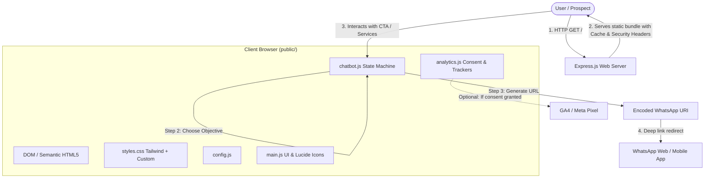
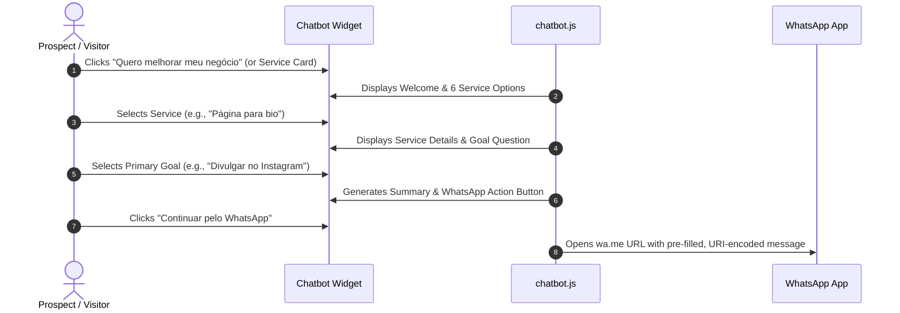

# LVS Bio — High-Conversion Link-in-Bio Platform

> A high-performance, mobile-first "link-in-bio" landing page with an integrated qualification chatbot and automated WhatsApp lead handoff. Built with vanilla web standards, Tailwind CSS, and a Node.js/Express backend.

---

## 📑 Table of Contents

- [Overview](#-overview)
- [Key Features](#-key-features)
- [Technology Stack](#-technology-stack)
- [System Architecture](#-system-architecture)
  - [High-Level Data & Request Flow](#high-level-data--request-flow)
  - [Directory Structure](#directory-structure)
  - [Component Architecture & Modules](#component-architecture--modules)
- [Interactive Lead Funnel (Chatbot)](#-interactive-lead-funnel-chatbot)
- [Privacy & Analytics (LGPD / GDPR Ready)](#-privacy--analytics-lgpd--gdpr-ready)
- [Configuration](#-configuration)
- [Getting Started & Local Development](#-getting-started--local-development)
  - [Prerequisites](#prerequisites)
  - [Installation](#installation)
  - [Available Scripts](#available-scripts)
- [Deployment Guide (Render)](#-deployment-guide-render)
  - [Automated Blueprint Deployment](#option-a-automated-blueprint-deployment-recommended)
  - [Manual Web Service Deployment](#option-b-manual-web-service-deployment)
- [Production & Security Considerations](#-production--security-considerations)
- [Quality Assurance & Testing Checklist](#-quality-assurance--testing-checklist)
- [License](#-license)

---

## 🌟 Overview

**LVS Bio** is a conversion-oriented digital landing page designed to replace generic link trees. It is engineered specifically for micro-entrepreneurs, freelancers, and small businesses looking to present services professionally, qualify potential clients, and streamline customer acquisition directly into **WhatsApp**.

Unlike bloated website builders, LVS Bio uses **zero client-side frameworks** (no React, Vue, or Angular overhead), achieving sub-second load times, excellent Lighthouse performance scores, and maximum conversion rates on mobile networks.

---

## 🚀 Key Features

- **Blazing Performance:** Pure HTML5, compiled CSS, and modular Vanilla ES6+ JavaScript for instant hydration and zero bundle bloat.
- **Automated Lead Qualification Chatbot:** A lightweight, client-side state machine that guides prospects through a 3-step qualification flow (service selection &rarr; business objective &rarr; personalized WhatsApp message).
- **One-Click WhatsApp Integration:** Automatically encodes service inquiries into formatted WhatsApp text messages (`https://wa.me/...`).
- **Privacy-First Analytics:** Cookie consent banner conforming to LGPD/GDPR. Google Analytics 4 (GA4) and Meta Pixel scripts load **only after** explicit user consent.
- **Adaptive Design System:** Tailored dark aesthetic with sleek teal accents (`#1693A5`), light contrast cards, smooth entrance animations, and full accessibility support (`prefers-reduced-motion` and WCAG keyboard navigation).
- **Production-Ready Node.js Backend:** Express server configured with security headers, asset caching strategies, 404 fallback routing, and health checks (`/healthz`).

---

## 🛠 Technology Stack

### Frontend Core
| Technology | Role | Description |
|---|---|---|
| **HTML5 (Semantic)** | Structure | Accessible markup with semantic landmark tags (`<main>`, `<header>`, `<nav>`, `<section>`, `<dialog>`). |
| **Vanilla CSS & Tailwind CSS v3** | Styling | Utility-first styling compiled with custom color tokens and component layers. |
| **Vanilla JavaScript (ES6+ IIFE)** | Logic | Modular scripts isolated in Immediately Invoked Function Expressions for zero global namespace pollution. |
| **Lucide Icons** | Visuals | Crisp, lightweight SVG vector icons loaded from CDN with local fallback capability. |

### Backend & Tooling
| Technology | Role | Description |
|---|---|---|
| **Node.js (v18+)** | Runtime | Modern JavaScript server environment. |
| **Express.js (v4.x)** | Web Server | Lightweight HTTP server serving static files with caching policies and security headers. |
| **Tailwind CLI** | Build Tool | Compiles and optimizes CSS from `src/input.css` to `public/css/styles.css`. |
| **Custom Cross-Platform Runner** | Build Automation | Node script (`scripts/build-css.js`) resolving Windows PATH binary lookup issues. |

### Hosting & Infrastructure
| Technology | Role | Description |
|---|---|---|
| **Render Web Service** | Cloud PaaS | Continuous deployment directly from Git with native Node.js runtime and automated TLS certificates. |
| **Render Blueprint (`render.yaml`)**| IaC | Declarative Infrastructure-as-Code configuration for one-click provisioning. |

---

## 🏗 System Architecture

### High-Level Data & Request Flow



### Directory Structure

```text
lvs-bio/
├── .env.example              # Sample environment variables (e.g., PORT)
├── .gitignore                # Git exclusions (node_modules, logs, env)
├── package.json              # Project manifests, dependencies & npm scripts
├── package-lock.json         # Pinned dependency lockfile
├── render.yaml               # Render Blueprint specification (Infrastructure as Code)
├── server.js                 # Express HTTP server & middleware configurations
├── tailwind.config.js        # Tailwind CSS palette extensions and content matchers
├── README.md                 # Project documentation (this file)
│
├── scripts/
│   └── build-css.js          # Cross-platform compiler wrapper for Tailwind CLI
│
├── src/
│   └── input.css             # Tailwind source directives, custom layers & variables
│
└── public/                   # Static assets served by Express
    ├── index.html            # Main single-page application entrypoint
    ├── assets/
    │   ├── logo.png          # High-resolution brand avatar
    │   ├── favicon.png       # Browser tab favicon
    │   └── og-image.png      # Social graph preview image (1200x630 px)
    ├── css/
    │   └── styles.css        # Production compiled stylesheet
    └── js/
        ├── config.js         # User-editable business config (phone, links, tracker IDs)
        ├── analytics.js      # Privacy-first tracker loader and event dispatcher
        ├── chatbot.js        # Client-side 3-step conversation engine
        └── main.js           # Core UI event listeners, modal handlers & animations
```

### Component Architecture & Modules

1. **`server.js` (Backend Layer):**
   - Disables `x-powered-by` to prevent server fingerprinting.
   - Enforces security HTTP response headers (`X-Content-Type-Options: nosniff`, `X-Frame-Options: SAMEORIGIN`, `Referrer-Policy: strict-origin-when-cross-origin`).
   - Serves static assets with differentiated caching policies (`maxAge: 1h` for assets, `Cache-Control: no-cache` for `index.html`).
   - Exposes `/healthz` endpoint for uptime monitoring and zero-downtime rolling deploys.
   - Serves a graceful fallback for unmapped routes.

2. **`public/js/config.js` (Configuration Layer):**
   - Centralizes editable constants on the `window.LVS_CONFIG` global object.
   - Decouples client data (phone numbers, tracker IDs) from UI and logic code.

3. **`public/js/chatbot.js` (Funnel Engine):**
   - Manages state `{ step, service, goal, busy, isOpen }`.
   - Exposes public API `window.LVSChatbot.open(serviceKey?, source?)`.
   - Traps focus inside the modal and supports keyboard navigation (`Esc` to dismiss).

4. **`public/js/analytics.js` (Telemetry & Compliance):**
   - Reads/writes consent flag to `localStorage` under key `lvs_analytics_consent`.
   - Lazy-loads Google Tag Manager / GA4 and Meta Pixel only upon user acceptance.
   - Provides a unified `window.LVSAnalytics.track(eventName, params)` dispatcher.

5. **`public/js/main.js` (DOM Controller):**
   - Initializes Lucide SVG icons.
   - Connects data attributes (`[data-open-chat]`, `[data-cta]`, `[data-whatsapp]`) to analytics and chatbot triggers.
   - Observes scroll positions using `IntersectionObserver` to trigger smooth reveal effects.

---

## 💬 Interactive Lead Funnel (Chatbot)

The qualification chatbot eliminates friction by asking targeted questions before initiating a direct WhatsApp message.



### Pre-configured Service Catalog
1. **Bio Landing Pages (`bio`):** Structured links, business presentation, and advertisement traffic redirection.
2. **Lead Tracking Systems (`leads`):** Organizing commercial contacts, tracking opportunities, and centralizing leads.
3. **Dedicated Landing Pages (`landing`):** Specific offer promotion, advertising campaigns, and quote requests.
4. **Institutional Websites (`site`):** Company presentation, portfolio showcase, and brand credibility.
5. **General Overview (`general`):** High-level summary of all available solutions.
6. **Direct WhatsApp Channel (`direct`):** Immediate bypass directly to chat without questionnaire.

---

## 🔒 Privacy & Analytics (LGPD / GDPR Ready)

When `ga4MeasurementId` or `metaPixelId` is configured in `public/js/config.js`:
- A non-intrusive cookie banner appears at the bottom of the page.
- **Zero third-party tracking scripts** are injected prior to consent.
- If the user clicks **"Recusar" (Decline)**: Analytics remains deactivated, and the choice is persisted.
- If the user clicks **"Aceitar" (Accept)**: GA4 and Meta Pixel are loaded asynchronously, and pending events are flushed.

### Tracked Business Events

| Event Name | Trigger Condition | Parameters |
|---|---|---|
| `service_button_click` | Click on service-specific card or button | `{ service: string, source: string }` |
| `chatbot_open` | Chatbot modal opened | `{ source: string }` |
| `chatbot_service_select` | Option selected inside the chatbot | `{ service: string }` |
| `whatsapp_click` | WhatsApp CTA clicked anywhere on page | `{ source: string, service: string }` |
| `cta_click` | Generic call-to-action click | `{ cta: string }` |

---

## ⚙️ Configuration

All business-specific configurations are located in `public/js/config.js`:

```javascript
window.LVS_CONFIG = {
  // WhatsApp business phone (international format, digits only)
  whatsappNumber: '5582996402650',

  // Instagram Profile URL. Keep empty ('') to hide the Instagram link in the footer.
  instagramUrl: '',

  // Analytics measurement IDs. Leave empty ('') to completely disable tracking.
  ga4MeasurementId: '',  // Example: 'G-XXXXXXXXXX'
  metaPixelId: ''        // Example: '123456789012345'
};
```

### Brand Assets Replacement
To customize the branding, replace the following files in `public/assets/` while keeping the original filenames:
- `logo.png`: Square company profile image (recommended ~512×512 px).
- `favicon.png`: Browser tab icon (recommended ~128×128 px).
- `og-image.png`: Open Graph image for social link sharing (1200×630 px).

---

## 💻 Getting Started & Local Development

### Prerequisites
- **Node.js**: Version 18.0.0 or higher ([Download Node.js](https://nodejs.org/))
- **npm**: Version 8.0.0 or higher (comes bundled with Node.js)

### Installation

1. **Clone the repository:**
   ```bash
   git clone https://github.com/your-username/lvs-bio.git
   cd lvs-bio
   ```

2. **Install project dependencies:**
   ```bash
   npm install
   ```

3. **Configure local environment (optional):**
   ```bash
   cp .env.example .env
   ```

### Available Scripts

| Script | Command | Purpose |
|---|---|---|
| **Build CSS** | `npm run build` | Compiles and optimizes Tailwind CSS from `src/input.css` into `public/css/styles.css`. |
| **Watch CSS** | `npm run dev:css` | Watches `src/input.css` and template files, recompiling styles on save. |
| **Start Server** | `npm start` | Launches the production Express web server (`http://localhost:3000`). |
| **Full Dev Run** | `npm run dev` | Executes `npm run build` and boots the Express server. |

### Running the App Locally

To run the application with live style updates:

**Terminal 1 (CSS Compiler Watcher):**
```bash
npm run dev:css
```

**Terminal 2 (Express Web Server):**
```bash
npm start
```
Access the application by navigating to **`http://localhost:3000`** in your browser.

---

## 🚀 Deployment Guide (Render)

LVS Bio is pre-configured for zero-friction deployment on [Render](https://render.com) using both declarative Infrastructure-as-Code (Blueprint) and standard Web Service setup.

### Option A: Automated Blueprint Deployment (Recommended)

The repository includes a declarative `render.yaml` specification:

1. Push your repository to **GitHub** or **GitLab**.
2. Log in to [Render Dashboard](https://dashboard.render.com).
3. Click **New +** &rarr; **Blueprint**.
4. Connect your Git repository.
5. Render will detect `render.yaml` and configure:
   - **Service Type:** Web Service
   - **Environment:** Node.js (Node 20 runtime)
   - **Build Command:** `npm install && npm run build`
   - **Start Command:** `npm start`
   - **Health Check Path:** `/healthz`
   - **Instance Plan:** Free
6. Click **Apply**. Your service will build and deploy automatically with a free HTTPS URL.

### Option B: Manual Web Service Deployment

1. On the Render Dashboard, click **New +** &rarr; **Web Service**.
2. Select your repository.
3. Configure settings manually:
   - **Name:** `lvs-bio`
   - **Runtime:** `Node`
   - **Build Command:** `npm install && npm run build`
   - **Start Command:** `npm start`
   - **Health Check Path:** `/healthz`
4. Under **Advanced &rarr; Environment Variables**, add:
   - `NODE_VERSION` = `20`
5. Click **Create Web Service**.

> **Note on Build Dependencies:** The `tailwindcss` package is intentionally listed in `"dependencies"` (not `"devDependencies"`) inside `package.json` to guarantee that Render's production build step has access to the CLI compiler without pruning.

---

## 🛡 Production & Security Considerations

- **Security Headers:** Enforced directly in `server.js` using native Express middleware (`X-Frame-Options`, `X-Content-Type-Options`, `Referrer-Policy`).
- **Asset Caching:** Static assets inside `public/` are served with `maxAge: '1h'` and `ETag` generation, while `index.html` uses `Cache-Control: no-cache` to ensure users always receive the newest releases.
- **Port Binding:** The server listens on `0.0.0.0` and respects `process.env.PORT` dynamically assigned by PaaS providers.
- **Fail-Safe Startup:** Server checks for the presence of `public/css/styles.css` upon initialization and warns if the build step was skipped.

---

## 🧪 Quality Assurance & Testing Checklist

Before deploying changes, verify the following:

- [ ] **Mobile Responsiveness:** Page renders cleanly on mobile screen widths (360px - 414px) without horizontal scrollbars.
- [ ] **Chatbot Modal Boundaries:** Chat window stays within viewport on smaller devices (`max-width: 480px`).
- [ ] **WhatsApp Intent Generation:** Clicking each service and goal in the chatbot produces a well-formed `wa.me` URL with correct accents and Portuguese punctuation.
- [ ] **Keyboard Navigation:** Full page can be navigated using `Tab`, `Shift + Tab`, and `Enter`. The "Pular para o conteúdo" (Skip to content) link becomes visible on the first tab keypress.
- [ ] **Reduced Motion Support:** Enabling "prefers-reduced-motion" in system settings disables CSS keyframe animations and immediate transitions.
- [ ] **Health Endpoint:** Querying `GET /healthz` returns HTTP `200` with `{"status":"ok"}`.
- [ ] **Analytics Opt-in:** With tracking IDs configured, third-party scripts are blocked until the user explicitly accepts via the banner.

---

## 📄 License

This project is licensed under the **MIT License**. You are free to modify, distribute, and use it for commercial and personal projects.
